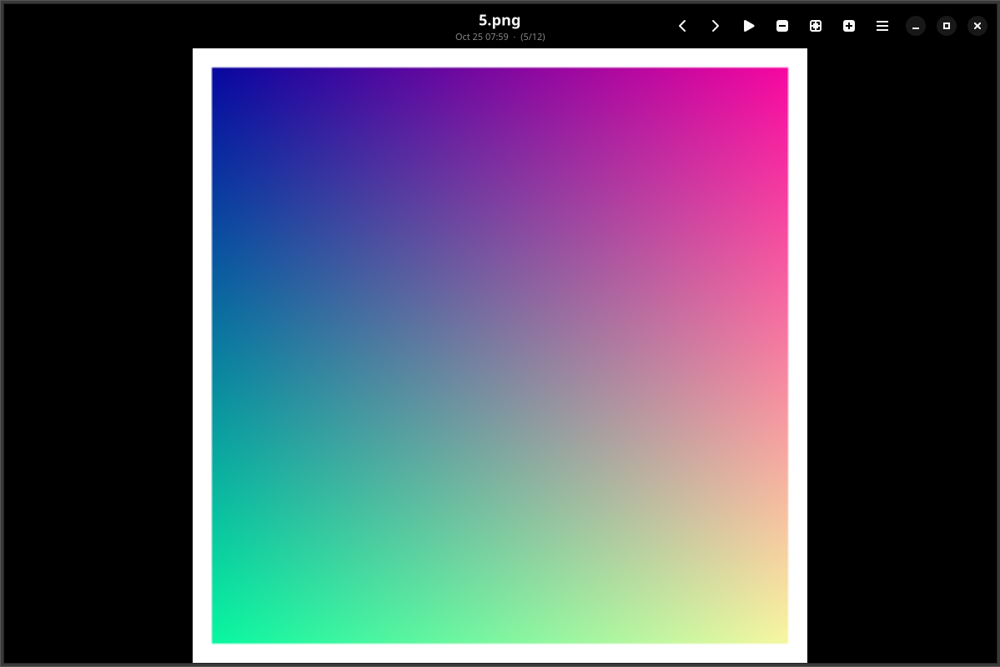
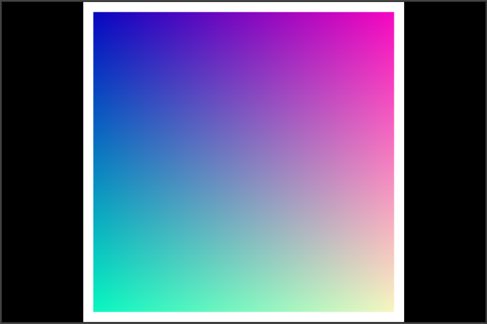
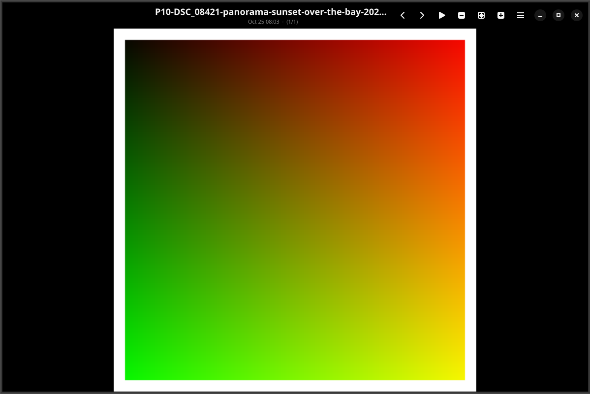

# Looksee

A fast, dark, single-window image viewer for Ubuntu (GTK4 / libadwaita).
Open an image, flip through the folder with `◀ ▶`, zoom, go fullscreen,
and loop the folder as a slideshow — default 5 s hard cuts, optional
220 ms crossfade.

| | |
|---|---|
|  | **The whole app.** OLED-black chrome; `◀ ▶` next/prev and the `▶` slideshow button sit right beside the zoom controls; live `index/total` subtitle. |
|  | **Immersive slideshow.** 5 s of pointer idle while playing and the chrome retracts — the photo owns the whole window. Move the mouse; it's back. |
|  | **Long names handled.** Camera-style filenames ellipsize instead of pinning the window wide. |

**At a glance:** windowed slideshow with configurable interval and hard-cut
default (optional 220 ms crossfade) · landscape/portrait slideshow filter ·
auto-hiding chrome with full-bleed images · OLED `#000000` window ·
look-ahead preload cache (current + 2 forward + 1 back, 200 MB budget) ·
tiered decoding for multi-megapixel files with transparent full-res zoom
upgrades · 100 % async filesystem I/O — slow mounts delay content, never
the UI (enforced by a lint test) · zoom 0.1×–8×, fullscreen, natural sort,
wrap-around, live folder monitoring.


## Run

    looksee [PATH]                         # installed

    /usr/bin/python3 src/looksee.py [PATH] # from a source checkout

`PATH` may be an image file (its folder becomes the album) or a directory.

Scanning is fully asynchronous (GLib async IO): the folder listing, the
slide decode, the file's modification time and the orientation probes all
arrive on the event loop — a slow mount (network/FUSE/restic) can delay
what you see, but never freezes the window.

## Controls

| Action | Control |
| --- | --- |
| Next / previous image | `→` `←`, headerbar `◀ ▶`, plain mouse wheel |
| Zoom in / out | `Ctrl` + mouse wheel, `+` / `-`, `− ⤢ +` buttons |
| Fit window | `1` (also the default view) |
| 1:1 pixels (scrollbars appear when the image overflows) | `0`, `⤢` |
| Fullscreen | `F11` (Esc leaves; headerbar hides while fullscreen) |
| Slideshow play / pause | `▶` headerbar toggle — loops the folder forever |
| Slideshow interval / crossfade | `⋮` menu (1–60 s in 0.5 s steps) |
| Slideshow orientation | `⋮` menu radios — All images / Landscape only / Portrait only (manual navigation is never filtered) |
| Auto-hide headerbar | automatic while playing: 5 s pointer idle hides it, any mouse activity reveals it |

## Settings

Written on change to `~/.config/looksee/config.json`:

```json
{"interval_sec": 5.0, "animations": false, "slide_orientation": "all"}
```

`slide_orientation` (`"all"`, `"landscape"`, `"portrait"`) filters
slideshow ticks only — landscape is `width > height`, portrait is
`height > width`, squares match neither, and a filtered slideshow that
finds no matching image stops by itself. Manual navigation is never
filtered.

Missing or corrupt settings fall back to the defaults above — the app
never crashes on them.

## Look-ahead cache

Looksee pre-renders the folder around the image you are looking at: it
keeps the **decoded** pictures for `i`, `i+1`, `i+2` and `i−1` — the
current image, two forward, one back (wrapping at the folder edges) — so
forward and back steps land instantly on a ready pixbuf instead of
decoding from disk.

- The cache is pruned to exactly that **3+1 window** after every
  navigation and after every folder change the file monitor reports;
  stale entries never linger and folder churn can only shrink it.
- Hard memory bound: every entry is charged `width × height × 4` bytes
  and the cache stays under **200 MB** total. If a new picture would
  breach the bound, the furthest look-ahead is dropped first (+2 before
  +1); if it still does not fit, the picture simply is not cached.
- Decoding happens **one image per idle tick** at low main-loop priority
  — the UI never waits on the cache, and a queued decode that scrolled
  out of the window before its tick is skipped, never executed.
- No knobs, no settings, no schema changes: the window size and the cap
  are fixed by design, and closing the window releases the whole cache.

## Performance on large images

Multi-megapixel photos decode in two steps. Slide loads and the
look-ahead cache first decode at **viewport resolution** — long edge
2x the viewport, clamped to [1024, 4096]; pictures already smaller than
that decode at native size. On the reference box a 16 MB 8000x6000 JPEG
decodes full-size into a 144 MB pixbuf (cache charge 192 MB = 96% of
the 200 MB budget, so the cache fits **one** such slide) while the
tiered first paint charges **17 MB** — the same budget now holds about
a dozen giants. Decode *time* is flat across tiers on this GdkPixbuf
build and every load runs through the async IO layer anyway (see *On
very slow mounts*), so the tiering buys memory and cache viability at
an invisible time cost, and no 144 MB buffer is decoded just to feed a
4096 px texture.

- **Deep zoom upgrades.** Zooming past the detail that is actually
  decoded (>1.05x beyond the loaded size) starts exactly **one**
  background full-resolution decode of the *current* picture — the
  current view stays on screen until the sharper pixels arrive. The
  full-res copy is transient: it is not charged to the cache budget,
  the on-screen texture stays capped at 4096 px, and it is dropped —
  cancelling the decode — on navigation or when you zoom back to <=1x
  of the tiered detail.
- **Window growth.** Enlarging the window by more than 25% re-decodes
  the current picture once at the new tier (debounced 300 ms), so
  zooming in after a resize never shows upscaled pixels. Shrinking
  never re-decodes.
- **Non-goal.** EXIF orientation handling is unchanged: orientation
  still comes from the decoder at load time and the slideshow
  orientation filter keeps probing in the background.

## OLED black UI

The window and headerbar paint true `#000000` (OLED pixels fully OFF).
One CSS provider is scoped to those two widgets only: the headerbar is
flat (no border, no shadow) and the image area is transparent so the
window black shows through. Popovers, menus, buttons and spins keep
libadwaita's default colors — nothing else is re-skinned, there is no
setting and no knob.

## Auto-hide chrome

While a slideshow **plays**, the headerbar retracts after **5 seconds of
pointer inactivity** so the picture owns the whole window. Any mouse
movement, click, or wheel event brings it back and re-arms the countdown
(the keyboard never does). Stopping or pausing playback always reveals
the headerbar; there is no setting and no knob.

## On very slow mounts

Network shares, FUSE bridges and backup mounts (rclone, restic, sshfs)
can take seconds to answer even trivial file questions. Looksee is built
so that never freezes the window:

- **Nothing on the hot path blocks.** Folder enumeration
  (`enumerate_children_async` + batched `next_files_async`), picture
  decoding, file metadata and orientation probes are all GLib async IO —
  there is no synchronous storage call left in the app (a static lint,
  `tests/test_no_sync_fs.py`, keeps it that way).
- **Chrome answers instantly.** Opening a folder updates the title bar
  right away; the listing swaps in atomically when the mount finally
  answers — you never see a half-scanned folder, and the picture on
  screen stays exactly where it was until the new one arrives.
- **Slow is late, not stuck.** Navigating while a decode is in flight
  cancels it; superseded folder scans are cancelled the same way; the
  subtitle shows `(i/N)` immediately and merges the file's date when the
  mount delivers it. A file that answers in 30 s costs you 30 s of
  *patience*, not 30 s of dead UI.
- **Slideshow honesty.** With the orientation filter active, a slide is
  only skipped or landed on once its dimensions are actually known —
  probes run in the background, and auto-stop waits for the truth
  instead of guessing.

There is deliberately no spinner or progress bar: the picture area
always shows *something real*, and everything else arrives when it can.

## Known behavior

- Long filenames truncate with an ellipsis in the header bar instead of
  pinning the window's minimum width — you can always resize the window
  smaller than the title text.

## Build the .deb

    packaging/build-deb.sh      # -> buildout/looksee_0.2.2_all.deb (+ .sha256)

## Install (Debian/Ubuntu)

    sudo apt install -y ./buildout/looksee_0.2.2_all.deb

To make Looksee the default image viewer (the MIME list matches GNOME
Loupe's), for each type you care about:

    xdg-mime default pro.krisforbes.Looksee.desktop image/jpeg
    xdg-mime query default image/jpeg     # -> pro.krisforbes.Looksee.desktop

Remove with `sudo apt remove looksee`.

## Development checks

    /usr/bin/python3 -m unittest discover tests   # pure-logic suite
    scripts/headless-smoke.sh src/looksee.py testdata/1.png   # xvfb smoke
    LOOKSEE_SMOKE_MODE=quit scripts/headless-smoke.sh scripts/smoke_p7_cache.py  # look-ahead cache
    LOOKSEE_SMOKE_MODE=quit scripts/headless-smoke.sh scripts/smoke_p14_asyncload.py  # async slide load (slow-mount sim)
    LOOKSEE_SMOKE_MODE=quit scripts/headless-smoke.sh scripts/smoke_p15_asyncscan.py  # async folder scan (slow-mount sim)

## For AI coding agents

[AGENTS.md](AGENTS.md) — build/test contract, the GTK-API drift ledger,
and the two rules the test-suite enforces mechanically.

## License

MIT — see [LICENSE](LICENSE). Release history in [CHANGELOG.md](CHANGELOG.md).
